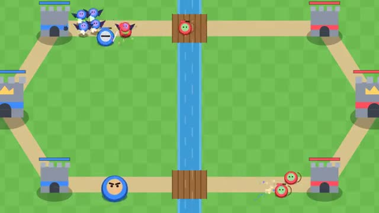

# Lane Clash

Play cards, send units, take their towers. A multiplayer starter game from [Multiplayer Agent](https://multiplayeragent.com): 2D, versus, 2 players, with a bot that plays the other side when you're alone.

## How it plays

Elixir fills over time. Drag a card onto your side and its units march down a lane. Take more towers in two and a half minutes, or their king tower, to win.

**Controls:** Drag a card onto the field, or tap a card then tap the field.

## Make it yours in the Game Builder

Open the [Game Builder](https://multiplayeragent.com), choose **Start from a starter game** and pick Lane Clash. It opens as version 1 in your studio, ready to play and publish. Then ask for changes, for example:

- Add a spell card that hits an area
- Add a third lane
- Let players build a deck before the match

## Run it yourself

1. Get a free publishable key (`pk_…`) at [multiplayeragent.com](https://multiplayeragent.com).
2. In `index.html`, put it in place of `pk_REPLACE_ME` in the `MP_CONNECT` block.
3. Open `index.html` in a browser. No build step and no server needed.

Without a key it still runs, offline against the bot.

## How it is built

- One `index.html`. The comment at the top of the script maps the code and explains the multiplayer.
- **Host-run rules:** The host's browser runs every unit and tower; if it leaves, the next player takes over.
- **Bots:** A bot plays the other side when you're alone, and a friend who joins takes over from it.
- **Live sync:** Both players see the same fight, about 10 updates a second.
- **Leaderboard:** Most wins, shown after every match.
- `?attract` runs it offline, bot against bot. The preview video is recorded from it.

## License

MIT.
